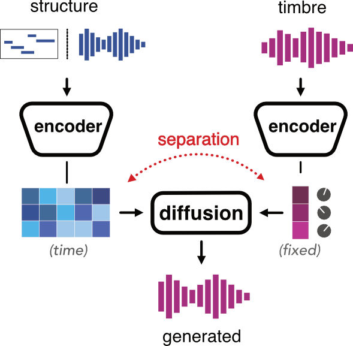

# AFTER training guide 

<!-- ## General principle  -->

__AFTER__ is a diffusion-based generative model that generates audio by blending two sources: a timbre representation, and a stream (either audio or MIDI) that shapes the signal structure (melody, dynamics) over time.

<p align="center"></p>


AFTER learns to map audio inputs into separated timbre and structure representations using two distinct encoders. Those representations are passed to a diffusion decoder that generates a transfer of structure information to the timbre target domain. 

The training is done in two phases : first learning a good timbre representation, then training the structure and diffusion decoder. 

AFTER operates in the latent space of a neural audio codec instead of directly generating audio waveform. The codec's task is to compress the high-dimensional audio into compact and informative embeddings, which enables the diffusion model to run more efficiently and focus on semantic content rather than high-frequency details. We provide more details about the autoencoder selection or training in [this section](#about-the-autoencoder). 

### Learning Timbre 


The first stage focuses on learning a timbre representation. By default, this is done following a [SimDINO](https://arxiv.org/abs/2306.00989) self-supervised objective.

It consists of creating multiple views of the same audio and training the model to map related samples to a similar timbre representation vector. In practice, this is done by randomly cropping different segments from the same audio file. The underlying assumption is simple: two different crops from the same source should share timbre, but contain different notes, rhythm and dynamics.

During data preprocessing, audio files are chunked by default into 12-seconds segments, while the training size corresponds to only 6-seconds. This means the model sees pairs of segments that are relatively close in time, and hence likely to share similar timbre features. If your dataset contains long recordings with stable timbre, increasing the chunk size (`--num_signal` in prepare_dataset) can improve performance by exposing the model to more structural variation per example.

However, two crops from the same file can share similar structure characteristics. If they contain the same harmony, similar note density, or nearly identical attacks, the encoder can encode those features instead of pure timbre. To prevent this, `after prepare_dataset` applies different data augmentations to each crop. By default, we use time-varying time-stretching and pitch shifting. Note that some augmentations may harm timbre consistency depending on the dataset (e.g. pitch-shifting speech). You can edit the augmentation settings in `after_scripts/prepare_dataset.py`.


### Learning separated spaces 


Once the timbre representation is learned, we train the structure encoder and diffusion model with a diffusion autoencoder framework. This means that the diffusion model must reconstruct a target signal from a noisy version, conditioned on timbre and structure representations. The timbre encoder is frozen during this phase.

Without constraints, the structure encoder could encode everything, making timbre irrelevant. To prevent this, AFTER introduces an adversarial classifier that tries to predict timbre information from the structure. The classifier weights are used to train the structure encoder to fail this prediction. 

The most important disentanglement hyperparameter for audio-to-audio training is `ADV_WEIGHT`. You can write your own config, or override it at launch time with the `--adv` flag.

- `--adv` is too low: structure leaks timbre, transfer becomes weak or inconsistent
- `--adv` is too high: the model loses local fidelity, pitch and rhythm tracking degrade

The ideal value depends on how entangled timbre and performance are in the dataset.

## MIDI

Using MIDI as the structure input simplifies the disentanglement problem. The model no longer needs to fight an audio structure encoder that can learn timbre information, so the MIDI configs set adversarial disentanglement to zero.

### Automatic MIDI Extraction

If you only have audio, you can ask dataset preparation to extract MIDI with Basic Pitch:

```bash
after prepare_dataset \
  --input_path /audio/folder \
  --output_path /datasets/after_latent_midi \
  --emb_model_path autoencoder_runs/AE_model_name/export.ts \
  --midi True
```

Transcription errors directly limit the quality of MIDI-to-audio training. If the transcription is rhythmically unstable, harmonically incomplete, or merges nearby notes, the diffusion model will reproduce those errors at inference time. 

### Using paired MIDI files

If you already have MIDI files you can use them instead:

```bash
after prepare_dataset \
  --input_path /audio_with_matching_midis \
  --output_path /datasets/after_latent_midi \
  --emb_model_path autoencoder_runs/AE_model_name/export.ts \
  --parser simple_midi
```

The files must be time-aligned with the audio files. The default `simple_midi` parser is defined in `after/dataset/parsers.py`. It assumes each MIDI file shares the audio filename and replaces the audio extension with `.mid`.

Example:

- `track01.wav` -> `track01.mid`

If your naming scheme differs, edit `simple_midi` directly or add a new parser in `after/dataset/parsers.py`, register it in `get_parser()`, and then pass that parser name with `--parser`.


### MIDI Time Resolution

By default MIDI is sampled at 4 times the latent space frame rate. If you need more precise timing, you can modify the config:

```gin
diffusion.utils.collate_fn_after:
    compress_tc = 4
```

## About the Autoencoder

The autoencoder is responsible for compressing audio into a compact latent representation used by the diffusion model. 

We provide code to train your own autoencoder. The architecture is a convolutional model inspired by approaches such as [RAVE](https://github.com/acids-ircam/RAVE) and Magenta [SpectroStream](https://arxiv.org/abs/2508.05207), designed to balance reconstruction quality and efficiency.

Training the autoencoder is typically the most computationally expensive part of the pipeline, and can take up to a week on a single RTX 4090 depending on dataset size and configuration.

Alternatively, you can use a pretrained model. RAVE models are a common choice, but they are often strongly regularized to enable timbre transfer, which can lead to imperfect reconstruction. In the context of AFTER where transfer is done by the diffusion model, this will unnecessarly limit the overall audio quality.

Another option is to use an off-the-shelf pretrained neural audio codec such as Music2Latent. This works well for offline generation, but for real-time applications you will need a codec that supports streaming inference and can be exported to TorchScript.


## Export and inference 

Once the model is trained you can export it to a **torchscript** file with the scripts `after export` and `after export_midi`.


The export script trains a small autoencoder to further compress the 6-dimensional timbre space to a 2-dimensional plane, which can be used to create a map that acts as a coarse control to navigate timbral features. The colors on the map are derived from the timbre vectors of the training dataset, colored by their labels. You can use the dataset identity (`--label_mode dataset`), the file names (`--label_mode file`) or any other metadata that you stored during data preprocessing (by writing you own parser in `after/dataset/parsers.py`). 

Note that this compression is lossy, meaning that using only the map will discard some fine timbre details. Furthermore, interpolations in the original timbre space are much smoother than interpolations performed on the map.
## Online AFTER training, pretrained SSL and MeanFlow

Prepare a lightweight waveform manifest with paired MIDI paths (MIDI remains
sparse on disk):

```bash
conda run -n after python -m after_scripts.prepare_dataset \
  --input_path=/path/to/GAPS/audio --midi_folder=/path/to/GAPS/midi \
  --parser=simple_midi --lazy --normalize=false \
  --output_path=/path/to/gaps_lazy --sample_rate=44100 --num_signal=65536
```

`--lazy` also supports `simple_audio` and `slakh`. Paired parsers record
`midi_path` relative to the manifest's source root; they do not extract MIDI.
Existing waveform-only manifests can still train audio structure models.

Train directly from that manifest, encoding augmented waveforms on the training
device with the frozen codec:

```bash
conda run -n after python -m after_scripts.train \
  --config=midi_simdinov2 --db_path=/path/to/gaps_lazy \
  --emb_model_path=/path/to/codec.ts \
  --ssl_checkpoint=/path/to/ssl_run/checkpoint100000.pt \
  --name=after_meanflow --n_signal=64 --batch_size=8 --num_workers=4 \
  --device=cuda --precision=bf16
```

The SSL config defaults to `config.gin` beside the checkpoint; override it with
`--ssl_config`. ECAPA architecture, normalization, embedding width, and the mel
transform all come from that SSL config. The post-encoder input width is inferred
from the student; the codec latent width remains independent. Mel students need
lazy waveform datasets. Codec/sample-rate/channel settings must match the SSL run.

To start from scratch, pass the SSL config without a checkpoint:

```bash
conda run -n after python -m after_scripts.train \
  --config=midi_simdinov2 --ssl_config=ssl_mel \
  --db_path=/path/to/gaps_lazy --emb_model_path=/path/to/codec.ts \
  --name=after_from_scratch --device=cuda --precision=bf16
```

This runs SSL pretraining with that config's objective, views, augmentations and
training schedule, then starts diffusion at step zero. Add `--skip_ssl` to skip
SSL pretraining and train diffusion with a randomly initialized ECAPA built from
the same config. `midi_simdinov2.gin` contains neither ECAPA architecture nor SSL
training settings. Older configs retain their legacy inline SimDino path.
`train_ssl.py --evaluate_sol=false` disables the optional SOL probe when its
dataset is unavailable; configured inline pretraining does not run that probe.

`midi_simdinov2.gin` uses `DenoiserV3` and MeanFlow. Its raw MIDI has four frames
per codec latent (`compress_tc=4`): a 256-sample hop with a 1024-hop codec.
Structure-encoder ratios `[1,2,2]` downsample by four, matching the diffusion's
1024-sample hop. The codec hop is detected, not hard-coded. The original configs
and Rectified Flow remain available. For RF with V3, set
`DenoiserV3.meanflow=False` and
`diffusion.model.build_diffusion.model=@diffusion.model.RectifiedFlow`.

For SIGReg on the post-encoder timbre space, change this binding in your diffusion
config (the default remains VAE regularization):

```gin
diffusion.networks.LinearEncoder.regularisation = "sigreg"
diffusion.model.Base.fit.regularisation_weight_cond = 0.0002
```

SIGReg measures how random 1D projections of a batch match a standard Gaussian.
It returns the regularizer through the existing `cond_reg` loss path and does
not sample a VAE latent. Its statistic runs in FP32 during BF16 training.
`after.regularisation.SIGReg` exposes `knots` and `num_projections` for tuning.

Online augmentations reuse `after.encoder_ssl.audio_augmentations` with
`WholeAudioAugmentation`, applying each transform once to the whole crop.
`OnlineWaveformDataset.structure_augmentation` jointly transforms the generation
target and its MIDI/audio structure; `timbre_augmentation` is independent.
The `midi_simdinov2` config uses separate Gin scopes: structure time stretch
(`min_rate=0.8`, `max_rate=1.2`, `p=0.5`) and pitch shift
(`min_semitones=-3`, `max_semitones=3`, `p=0.5`), and an empty timbre list.
MIDI-paired pitch shifts sample integer semitones. Pitch and stretch use the
shared Signalsmith backend. Whole-crop time stretch requires
`leave_length_unchanged=False`; the loader reads enough context for the maximum
stretch rate of either branch and crops after augmentation without padding.
To enable timbre loudness augmentation, for example:

```gin
timbre/after.encoder_ssl.audio_augmentations.loudness:
    min_gain_db = -6.0
    max_gain_db = 0.0
    p = 0.5
timbre/after.encoder_ssl.audio_augmentations.WholeAudioAugmentation:
    transforms = [@timbre/after.encoder_ssl.audio_augmentations.loudness()]
```

An empty transform list disables that branch's waveform augmentation.
Validation disables augmentation. File splitting happens before random crops.
Each worker caches at most 32 sparse MIDI note arrays; only the selected crop's
piano roll is allocated. Waveforms are read with enough context for stretching,
which excludes files too short for that context.

`--precision=bf16` enables CPU/CUDA autocast in both `train.py` and `train_ssl.py`.
Parameters, codec encoding, finite-difference MeanFlow derivatives, and MSE
reductions remain FP32. The default is `--precision=fp32`; BF16 on MPS is rejected.
MeanFlow predicts an interval velocity and supports one-step generation; its
finite difference uses dropout-free evaluations.

MeanFlow lives in `after/diffusion/model.py`, immediately below RectifiedFlow,
and inherits `Base` directly. Both models implement `diffusion_step`,
`model_forward` and `sample`; time/interval tensors have shape `[B,1,1]`.
The Gin selector is `diffusion.model.build_diffusion.model = @diffusion.model.MeanFlow`.
Older saved Gin configs must replace `diffusion.meanflow` with `diffusion.model`;
checkpoint tensor keys are unchanged.

The important MeanFlow settings are:

| Setting | Default in `midi_simdinov2` | Meaning |
| --- | --- | --- |
| `Base.drop_rate` | `0.3` | Probability of dropping MIDI structure during training; timbre stays supplied. |
| `MeanFlow.fm_fraction` | `0.5` | Batch fraction with `h=0`, anchoring the instantaneous field. |
| `MeanFlow.guidance_omega_max` | `8.0` | Upper bound of log-uniform omega sampling, starting at 1. |
| `MeanFlow.guidance_t_max` | `0.8` | Apply the guided target only up to this time (`0=noise`, `1=data`). |
| `MeanFlow.guidance_apg_eta` | `0.0` | Remove the APG correction's parallel component; `None` disables APG. |
| `MeanFlow.guidance_apg_r` | `0.15` | Relative norm cap for the APG correction. |
| `MeanFlow.dde_eps` | `0.002` | Central finite-difference step for the MeanFlow derivative. |

There is no `p_drop_timbre` setting. The common training loop drops MIDI only;
`timbre_noise_aug` adds noise to its embedding and does not drop timbre.
Time-distribution parameters (`logit_mean=0.4`, `logit_std=1.0`) and adaptive-loss
parameters (`adaptive_p=1.0`, `adaptive_c=0.001`) retain defaults in `model.py` and
can be overridden through Gin when needed.

`midi_simdinov2.gin` trains guidance into MeanFlow using omega conditioning,
with these bindings:

```gin
diffusion.networks.transformerv3.DenoiserV3.guidance_embed = True
diffusion.model.MeanFlow.guidance_enabled = True
diffusion.model.MeanFlow.guidance_omega_max = 8.0
diffusion.model.MeanFlow.guidance_t_max = 0.8
diffusion.model.MeanFlow.guidance_apg_eta = 0.0
diffusion.model.MeanFlow.guidance_apg_r = 0.15
```

Each training sample draws omega log-uniformly in `[1,8]`. Its instantaneous
velocity target receives `(1-1/omega) * stop_gradient(v_cond-v_without_midi)`
for `t <= 0.8`. Both predictions use `h=0`, the same omega, and exactly the same
timbre embedding; only MIDI structure is replaced by the drop value in the
reference. Both MeanFlow losses use the guided target, and the DDE probes hold
omega fixed. The existing MIDI dropout is preserved; timbre is always supplied.

APG modifies the correction in denoised-latent space: its norm is capped to 15%
of the predicted denoised latent's norm, then its parallel component is removed
(`eta=0`). Geometry is computed per frame, preserving causality. Set
`guidance_apg_eta=None` to disable APG. APG is part of training, so it introduces
no extra inference evaluation.

In Python, `MeanFlow.sample(..., nb_steps=1, guidance_structure=3.)` queries
`u(noise,t=0,h=1,omega=3)` once. The nn~ attribute `guidance_structure` likewise
sets omega; there is no conditional/reference blend during guided inference.
Omega must be positive; the trained range is `[1,8]`. `guidance_timbre` must stay
at `1`: this model does not drop or independently guide timbre. Changing omega
in an exported stream resets its solver-stage history.

This requires training with the omega embedding and guided target. Existing
checkpoints do not gain learned one-step guidance by changing a sampling flag.

Older configurations default to `guidance_enabled=False` / `guidance_embed=False`
and retain two-pass, structure-only inference CFG. When switching this config
to RF, also disable both guidance flags.

Export uses the saved RF/MeanFlow choice and the same codec hop:

```bash
conda run -n after python -m after_scripts.export_midi \
  --model_path=after_runs/after_meanflow --emb_model_path=/path/to/codec_stream.ts \
  --latent_project=false
```

`export_midi.py` and `export.py` keep the nn~ TorchScript interfaces. V3 commits
KV history during each forward call, separately for each solver stage. Changing
step count or guidance clears that history. Use a streaming codec for real-time
audio. `--latent_project=false` avoids the optional LMDB-based timbre-map
training when the run uses online datasets. V3 can also be scripted directly
with `torch.jit.script(net)`; call `reset_stream()` before a new sequence or
changing device, dtype, batch layout, or solver schedule.
